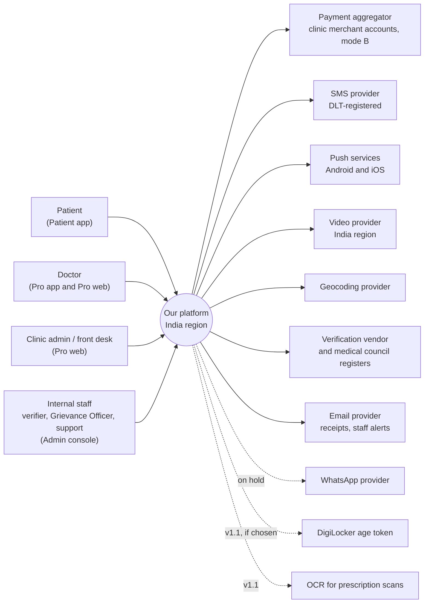
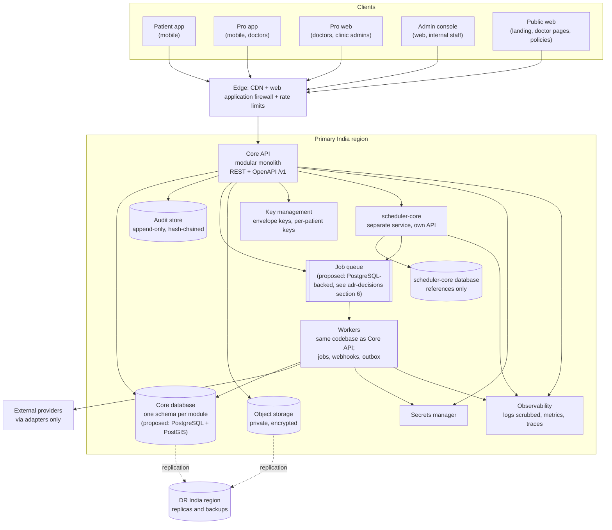
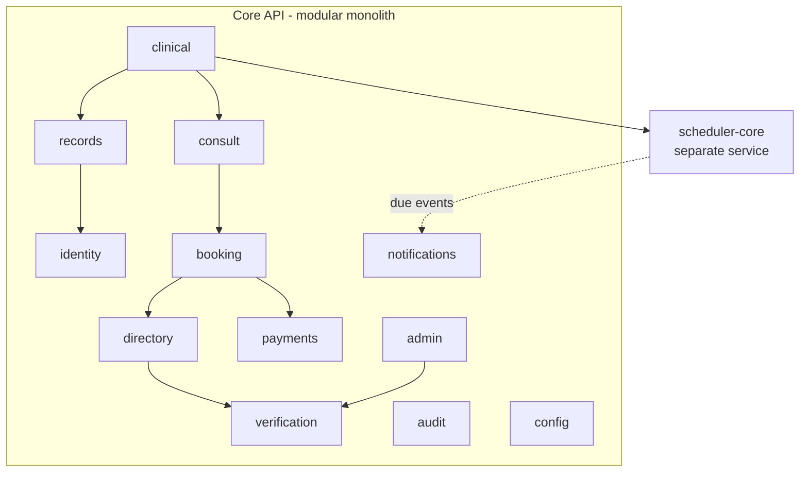
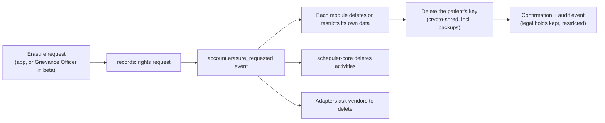

# Architecture overview (S-034)

**Phase P05 · Epic EP07 · Depends on:** S-004 ([requirements-v1.0.md](../requirements-v1.0.md)) · **Contract refs:** K-ARC-01 (and reviewed against all K-rules, section 8) · **Date:** 2026-11-15 · **Status:** Done (acceptance criterion: diagrams in /docs/arch, reviewed against contracts)

**Who this is for:** everyone who designs or builds the system, and the founder when choosing the tech stack.

> **Stack-neutral on purpose.** The tech stack is not decided yet (ADR-02 to ADR-07, ADR-09 to ADR-11, ADR-24 and ADR-25 are open; see [adr-decisions.md](adr-decisions.md)). Every diagram here names a **role** ("relational database", "job queue"), not a product. The proposed product is shown in brackets where it helps. Nothing in this document changes when the stack is chosen.

## 1. What we are building (v1.0)

"Consult → Prescription → Reminders" for adult patients in one city ([scope-v1.0.md](../scope-v1.0.md)): verified doctors, booking for in-person and online consultations, clinic-collected payments (mode B), structured prescriptions checked by a rules engine, and reminders by push and SMS. WhatsApp is on hold, but its adapter slot is kept.

**Architecture style (ADR-01):** one **modular monolith** (many modules, one deployable unit) plus **scheduler-core** as a separate service from day 1. Modules are separated by code boundaries and database permissions, so any of them can be extracted into a service later (K-ARC-01).

## 2. System context: who and what talks to us



- **Dashed lines** are not built in v1.0. Their adapter interfaces still exist ([adapter-interfaces.md](adapter-interfaces.md)).
- **Every external system is reached only through an adapter** (K-ARC-03), and receives personal data only once it is in the vendor register with a processor agreement (K-DP-08).
- **Reporting to authorities** (CERT-In, the Data Protection Board) is a manual process in the [incident response runbook](../security/incident-response-runbook.md), not a system integration.

## 3. Containers: the deployable pieces



| Container | Responsibility | Notes |
|---|---|---|
| Patient app | Search, book, pay, consult, records, reminders | Keeps a local copy of upcoming reminders, so they fire offline (ADR-19). Separate from the Pro app so patient and professional permissions never mix (ADR-04). |
| Pro app and Pro web | Doctor schedule, consults, notes, prescribing; clinic admin settings | Doctors prescribe mostly on desktop, so Pro web is a first-class client (ADR-05). Mandatory MFA; step-up authentication to sign a prescription (K-SEC-03). |
| Admin console | Verification review, grievances, support, just-in-time access | Separate web app on its own domain, with stricter network rules (K-SEC-08). |
| Public web | Landing page, doctor profile pages, policies | No personal data except the waitlist form. Doctor pages follow the NMC publicity rules ([doctor-registration-and-conduct.md](../clinical/doctor-registration-and-conduct.md)). |
| Core API | All business modules ([module-boundaries-and-domain-model.md](module-boundaries-and-domain-model.md)) | Stateless, so it scales horizontally. |
| Workers | Background jobs: webhooks, outbox relay, notification dispatch, reconciliation, erasure fan-out, PDF generation | Same codebase and module rules as the Core API, so module boundaries still apply. |
| scheduler-core | Activities, recurrence rules, occurrences, due events | Own process, API and database, with its own role. Recommended: on the **same managed database server** as the core database (option b, section 2a of [adr-decisions.md](adr-decisions.md)) to keep running costs low. **Never imports health modules or stores health data** (K-ARC-02). |
| Core database | One schema per module; each module's database role can read only its own schema | The database enforces "no module reads another module's tables" (K-ARC-01). |
| Audit store | Append-only audit events with a hash chain | **Durable first, chained later:** each audit event is inserted into an `audit_outbox` table **in the same database transaction** as the change it records. For reads, it is inserted before the data is returned; if that insert fails, the read fails (fail closed). A worker then moves events into the hash-chained store. A crash can delay an event, but cannot lose it. Stores references, not content, so erasure doesn't break the chain. |
| Object storage | Uploads, prescription PDFs, verification evidence | Private buckets in India; short-lived signed links; encrypted with KMS keys (ADR-08). |
| Key management | Envelope encryption; one key per patient for sensitive fields | Deleting a patient's key makes their encrypted data unreadable everywhere, including backups (crypto-shredding, K-DP-03, K-DP-07). |

## 4. Module map (summary)

Full detail, data ownership and allowed dependencies are in [module-boundaries-and-domain-model.md](module-boundaries-and-domain-model.md).



- Arrows mean "calls the public interface of" or "subscribes to the events of". No arrow means no direct dependency.
- `audit`, `config` and `identity` are used by every module, so their arrows are left out.
- Not in v1.0: family, emergency, reviews, labs, pharmacy, homecare. Their slots are reserved in the module map.

## 5. Key data flows (v1.0)

### 5.1 Book and pay (mode B: clinic-collected)

```mermaid
sequenceDiagram
  autonumber
  participant P as Patient app
  participant B as booking
  participant PY as payments
  participant AD as Payment adapter
  participant AG as Aggregator (clinic account)
  P->>B: Hold slot (Idempotency-Key)
  B-->>P: Slot held up to 15 min, refund policy version shown
  P->>B: Pay for hold
  B->>PY: Create order (appointment ref, amount, clinic)
  PY->>AD: Create order on clinic account (idempotency key)
  AD->>AG: Partner API create order
  AG-->>P: Hosted checkout (no card data reaches us)
  AG->>AD: Signed webhook: payment captured
  AD->>PY: Verified event (signature checked per clinic)
  PY->>PY: Append ledger entries (double-entry)
  PY-->>B: payment.captured event (via outbox)
  B->>B: Confirm appointment; store policy version
  B-->>P: Confirmed (push + SMS)
```

- **No webhook within 15 minutes:** payments polls the aggregator. A debit that arrives after the hold expired is refunded automatically (E-PAY-01, E-PAY-02).
- **Double booking:** prevented by a unique constraint on (doctor, slot) plus the short hold (Performance sheet).
- **Pay at clinic:** the same flow without the checkout steps. This is also the "payments off" kill switch.

### 5.2 Online consultation to signed prescription

```mermaid
sequenceDiagram
  autonumber
  participant P as Patient app
  participant D as Pro app / Pro web
  participant C as consult
  participant R as records
  participant CL as clinical
  participant RE as rules engine (in clinical)
  P->>R: Grant consult consent (time-limited)
  D->>C: Join room
  C->>C: Check doctor is Verified (K-CS-01)
  C-->>D: Room token (video adapter)
  P->>C: Join room
  C->>C: Record "both sides connected" (E-BK-08)
  D->>R: Read history
  R->>R: Check active consent and write audit event (K-DP-02)
  D->>CL: Draft prescription
  CL->>RE: Check consult mode, first or follow-up, drug lists
  RE-->>CL: Allowed / blocked with reason (under 50 ms)
  D->>CL: Step-up authentication (P08, K-SEC-03)
  CL->>CL: Electronic signature on document hash via adapter (P09, N5)
  CL->>CL: Freeze signed version (K-CS-05); store rule-set version
  CL-->>P: Prescription PDF (signed link) + notification
```

### 5.3 Prescription to reminders (through scheduler-core)

```mermaid
sequenceDiagram
  autonumber
  participant CL as clinical
  participant S as scheduler-core
  participant N as notifications
  participant P as Patient app
  CL->>S: Create activity (opaque ref, RRULE, time zone)
  S->>S: Generate occurrences 14 days ahead
  S-->>P: Occurrences sync (via Core API)
  P->>P: Schedule local reminders (offline backup)
  S->>N: occurrence.due (opaque ref only)
  N->>CL: Resolve reminder wording for ref
  CL-->>N: Neutral text; medicine name only if opted in (K-DP-09)
  N->>N: Quiet hours do not apply to medication reminders (K-MSG-03)
  N-->>P: Push, then SMS fallback (DLT template, K-MSG-01)
```

scheduler-core never sees a medicine name, a diagnosis or a phone number. It knows only "subject X has activity Y at 08:00 Asia/Kolkata" ([data-inventory-v1.0.md](../data-inventory-v1.0.md) §4.9).

### 5.4 Doctor verification

1. The doctor submits their council, registration number and documents. Evidence goes to object storage. **Aadhaar cards are rejected and deleted at once** (AAD-04, K-DP-05).
2. The verification state machine runs the checks through adapters: manual review (always available), and later a vendor or register API (S-111 is deferred until after the beta).
3. A reviewer decides in the Admin console. The decision and its evidence references are audit-logged.
4. directory lists the doctor and booking accepts bookings **only while the doctor is Verified**, checked on the server for every action (K-CS-01). A re-verification job moves expired doctors to "Suspended". **On suspension, booking cancels the doctor's future appointments automatically, payments refunds them in full (RF04), and patients are told and offered another doctor; the clinic is told too** (compliance review R-07, E-VER-06).

### 5.5 Refund when the doctor doesn't show

The consult or booking module records a no-show, using the "both sides connected" check or the clinic marking it. payments applies the versioned refund policy (RF01–RF09), then issues the refund on the clinic's account through the adapter with an idempotency key. The patient sees the refund status in the app (theme T02).

### 5.6 Erasure (data rights)



Each module owns its deletion code and reports completion. records tracks the request until every module has reported (K-DP-07).

## 6. Cross-cutting design

| Concern | Design | Contract / ADR |
|---|---|---|
| Module calls | In-process public interfaces for queries. Domain events through a **transactional outbox** (written in the same database transaction, then relayed by workers) for side effects. | K-ARC-01 |
| Authorisation | Deny by default. Role check plus ownership check in one policy layer, applied to every endpoint and tested by an automated suite. | K-SEC-04 |
| Consent | records answers "does an active consent exist?" from a short-lived cache that a revocation clears at once. Target under 20 ms. | K-DP-02 |
| Audit | Every read of patient data by someone other than the patient, and every state change, writes an audit event **durably**: in the same transaction for changes, before returning data for reads. Hash-chaining happens afterwards, in a worker. The cost is one small insert per request. | K-DP-02, K-CS-05 |
| Encryption | TLS 1.2+ (1.3 preferred) everywhere. Field-level envelope encryption for sensitive fields, with per-patient keys. | K-DP-03, ADR-12 |
| Logs and analytics | Structured logs pass through a scrubber, which removes health data, phone numbers, full identifiers and anything that looks like a 12-digit Aadhaar number (Verhoeff check). | K-DP-04, K-DP-05 |
| Country rules | Laws, drug lists, refund values, DLT templates, emergency numbers and provider choices live in **country packs** (versioned config). The code holds none of them. | K-GLB-01, ADR-18 |
| Time | Stored in UTC with an IANA time zone; recurrence follows RFC 5545. | K-ARC-04 |
| APIs | REST, OpenAPI 3.1, `/v1`, one error format, cursor pagination, idempotency keys ([api-standards.md](api-standards.md)). | K-ARC-06, K-PAY-02 |
| Feature flags | Every feature ships behind a flag. Consent, the rules engine, the prescribing gate, audit and encryption cannot be flagged off ([release-and-versioning.md](../process/release-and-versioning.md) §5). | ADR-23 |
| Health data standard | Own data model, mapped to FHIR R4 at the boundary (needed for ABDM in v2.0). | K-ARC-05, ADR-17 |

## 7. Deployment and data residency

- **Two India regions:** primary, and disaster recovery (ADR-09). All personal and health data, backups, logs and vendor processing stay in India (K-DP-01, K-GLB-03).
- **Environments:** local, staging (synthetic data only, never real patient data), production.
- **Networks:** the database, queue and object storage are private. Only the edge is public. The Admin console is reached only through an extra access control layer, such as an IP allow-list or zero-trust proxy.
- **Logs:** kept in India for the retention period. The contract says at least 180 days (K-SEC-01); 1 year is proposed in S-020 and waiting for a decision.
- **Recovery objectives** are still open (requirements §3.2). The proposal in [adr-decisions.md](adr-decisions.md) §4 is: up to 15 minutes of data loss, and service back within 4 hours.

## 8. Review against contracts (acceptance criterion)

| Rule | How the architecture meets it | Where it is enforced |
|---|---|---|
| K-ARC-01 modular monolith | Schema per module with separate database roles; import-boundary lint; events through the outbox | S-036, S-090 lint |
| K-ARC-02 scheduler-core isolation | Separate service and database; holds only opaque references; wording resolved by notifications | §5.3; contract test in S-068 |
| K-ARC-03 adapters | Every provider is behind an interface; lint blocks vendor SDK imports outside `adapters/` | [adapter-interfaces.md](adapter-interfaces.md) |
| K-ARC-04 time | UTC + IANA zone; RRULE in scheduler-core | §6 |
| K-ARC-05 FHIR | Mapping layer at the records and clinical boundary; used from v2.0 | ADR-17 |
| K-ARC-06 API versions | `/v1`, OpenAPI source of truth, diff check and lint in CI | [api-standards.md](api-standards.md) |
| K-DP-01 residency | Both regions in India; vendors must have India processing | §7; vendor register |
| K-DP-02 consent and audit | records consent check plus audit event on every non-patient read | §5.2, §6 |
| K-DP-03 field encryption | KMS envelope keys; per-patient keys | §3, ADR-12 |
| K-DP-04 no health data in logs | Log scrubber; analytics without health data (ADR-26) | §6 |
| K-DP-05 no Aadhaar | No Aadhaar fields; validation rejects it; logs redact it | §5.4, [aadhaar-policy.md](../privacy/aadhaar-policy.md) |
| K-DP-06 data inventory | Every new field needs an inventory entry in the same PR | Process (PR checklist) |
| K-DP-07 erasure everywhere | Event fan-out to every module, scheduler-core and vendors; crypto-shredding | §5.6 |
| K-DP-08 vendor register | The adapter cannot be enabled in config until the vendor is in the register | [adapter-interfaces.md](adapter-interfaces.md) §2 |
| K-DP-09 notification content | Wording resolved at send time by clinical, with the opt-in check | §5.3 |
| K-DP-10 children | Not in v1.0 (adults only). family module reserved | Scope |
| K-CS-01 verified only | Server-side check in directory, booking, consult and clinical | §5.4 |
| K-CS-02 rules engine | Every prescription passes it; decision tables in the country pack | §5.2, ADR-18 |
| K-CS-05 immutable signed records | Signed versions frozen; changes create new versions | §5.2 |
| K-CS-07 clinical changes reviewed | Rule files change by PR with the doctor reviewer's approval | Release policy §2 |
| K-PAY-01 no card data | Hosted checkout only | §5.1 |
| K-PAY-02 idempotency and webhooks | Idempotency keys; signature-verified webhooks plus polling | §5.1, [api-standards.md](api-standards.md) |
| K-PAY-03 no wallet | Mode B: money goes to the clinic's account; we never hold it | §5.1 |
| K-PAY-04 append-only ledger | Ledger in the payments schema; no updates or deletes allowed | S-036 |
| K-PAY-05 versioned refund policy | Policy version stored with each booking | §5.1 |
| K-SEC-01 log retention | Logs in India; 180 days minimum, 1 year proposed | §7 |
| K-SEC-03 authentication | Patient OTP + device binding; professional MFA; step-up to sign | §3 |
| K-SEC-04 authorisation | Deny-by-default policy layer + automated suite | §6 |
| K-SEC-05/06 secrets and dependencies | Secrets manager; scans in CI | §3, release policy |
| K-SEC-08 staff access | Just-in-time access in the Admin console; break-glass alert | §3 |
| K-MSG-01/02/03 messaging | SMS adapter sends only template IDs; WhatsApp adapter disabled; quiet-hours rule in notifications | [adapter-interfaces.md](adapter-interfaces.md) |
| K-GLB-01/02/03 global | Country packs; translation keys; residency declared per pack | §6 |

**Gaps found:** none blocking. Two items depend on open decisions:
- log retention: 180 days or 1 year (S-020);
- recovery objectives ([adr-decisions.md](adr-decisions.md) §4).

## 9. Open items

- Tech stack decisions: [adr-decisions.md](adr-decisions.md) §3.
- Vendor choices: video (S-039), payments (S-040), messaging (S-041), verification (S-042).
- F8 option (symptom search) decides whether a symptom module exists in v1.x ([medical-device-software-assessment.md](../clinical/medical-device-software-assessment.md)).
