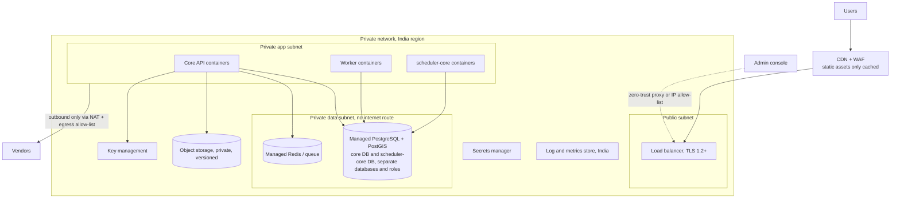

# Infrastructure, environments and disaster recovery (S-055)

**Phase P05 · Epic EP07 · Depends on:** S-035 ([adr-decisions.md](adr-decisions.md)) · **Contract refs:** K-DP-01 (also K-GLB-03, K-SEC-01, K-SEC-05, K-DP-07) · **Compliance:** C05, C07 · **Date:** 2026-11-15
**Status:** In Testing. The acceptance criterion needs **design approval** and **data residency confirmed**; both depend on the founder's cloud choice (ADR-09, open). The design is cloud-neutral, so it holds for any of the three clouds.

**Who this is for:** the infra lead (S-093, S-094, S-095), the security owner, and the founder choosing the cloud.

## 1. Environments

| Environment | Purpose | Data | Who can access | Deploys |
|---|---|---|---|---|
| Local | Developer machines; containers for the database, queue and storage emulator | **Synthetic only** | Developer | — |
| Dev | Shared integration | Synthetic only | Engineering | Every merge to a feature branch (optional) |
| **Staging** | Production-like; end-to-end tests; VAPT target (S-183) | **Synthetic only, never real patient data** (S-044) | Engineering, QA, auditor | Every merge to `main` (release policy §3) |
| **Production** | Real users | Real | Just-in-time only; no standing human access to data | Manual promotion by an approved person |
| **DR (production standby)** | Second India region; takes over if the primary fails | Replica of production | Same as production | Infra as code, same version as production |

**Rules:**
1. **Each environment lives in its own cloud account** (or subscription or project). Production and DR sit in a separate organisation unit with stricter policies.
2. **No production data is ever copied to staging, dev or a laptop.** For production-like volume tests, use synthetic data generators (S-084).
3. **Infrastructure as code for everything** (S-093). Manual console changes in production are blocked and alerted, except break-glass.

## 2. Topology (one region; DR mirrors it)

- **The database and queue have no public endpoints.** The app tier reaches vendors only through NAT, with an **egress allow-list** of vendor domains. That also limits server-side request forgery (TM-41).
- **The CDN caches only static assets.** API responses send `Cache-Control: no-store`, so no personal data is cached at edge locations, which may be outside India.
- scheduler-core has its own database and role on the same managed PostgreSQL server (ADR-01 option b).

## 3. Service mapping by cloud (choose in ADR-09)

| Role | AWS | Azure | Google Cloud |
|---|---|---|---|
| **India regions (primary / DR)** | Mumbai `ap-south-1` / Hyderabad `ap-south-2` | Central India (Pune) / South India (Chennai); also West India (Mumbai) | Mumbai `asia-south1` / Delhi `asia-south2` |
| Containers | ECS or EKS | Container Apps or AKS | Cloud Run or GKE |
| Managed PostgreSQL + PostGIS | RDS or Aurora PostgreSQL | Database for PostgreSQL (Flexible Server) | Cloud SQL for PostgreSQL |
| Redis / queue | ElastiCache | Azure Cache for Redis | Memorystore |
| Object storage | S3 | Blob Storage | Cloud Storage |
| Keys | KMS (multi-Region keys) | Key Vault (Managed HSM optional) | Cloud KMS |
| Secrets | Secrets Manager | Key Vault | Secret Manager |
| Restrict resources to India | Service control policy (region deny) | Azure Policy "allowed locations" | Organisation policy "resource locations" |
| WAF and CDN | WAF + CloudFront | Front Door + WAF | Cloud Armor + Cloud CDN |

*Region and service availability must be re-checked at decision time [VALIDATE], especially PostGIS support, multi-region keys and the managed identity service in India (ADR-11).*

## 4. Data residency confirmation (acceptance criterion)

Confirm every item before production. Each needs evidence: a screenshot, the IaC policy, or a vendor contract.

| # | Check | Evidence |
|---|---|---|
| R1 | An organisation-level policy **denies creating resources outside the two India regions** in production, DR and staging | Policy as code |
| R2 | Databases, backups, snapshots, object storage and replicas are all in India | IaC plus a monthly scan |
| R3 | **Logs, traces and metrics stored in India** (CERT-In, C07). A SaaS monitoring tool is used only if it offers India-hosted storage; otherwise self-host. | Vendor contract or IaC |
| R4 | Every vendor that receives personal data processes it in India, or is a listed exception approved by the lawyer (push via Google and Apple, no health data). **This includes crash reporting and app performance monitoring** (self-hosted or India-processing; review R-05) | Vendor register (K-DP-08) |
| R5 | The CDN caches no personal data | `no-store` headers test |
| R6 | Key material for India data stays in India regions | KMS configuration |
| R7 | The CI/CD system holds no production data. Build logs contain no secrets or personal data. | CI configuration |

## 5. Disaster recovery

**Targets (ADR-27, proposed):** up to **15 minutes** of data loss (RPO), service back within **4 hours** (RTO) [CONFIRM].

| Component | How it is protected | Restore |
|---|---|---|
| PostgreSQL | Point-in-time recovery (5-min log shipping) in the primary region; **cross-region asynchronous replica** in the DR region; daily snapshots copied to DR | Promote the DR replica, or restore to a point in time |
| Object storage | Versioning; cross-region replication to DR; deletes replicated too | DR bucket |
| Redis / queue | Not a source of truth. The outbox in PostgreSQL re-drives jobs after failover; reminders are regenerated from scheduler-core | Rebuild |
| Keys | Multi-region keys or replicated key material in the DR region. **Crypto-shredding must destroy a patient's key in both regions** (K-DP-07; S-062 designs this). | Same keys in DR |
| Secrets | Replicated to the DR region | — |
| Infrastructure | Same IaC applied to DR; warm standby at small size, scaled up on failover | Apply and scale |

**Failover runbook (written in S-186, drilled in S-185):**
1. Declare the incident (S-020).
2. Freeze writes in the primary, if it is reachable.
3. Promote the DR database.
4. Point DNS to DR.
5. Verify the health checks and the audit outbox.
6. Tell users if there is downtime.
7. Re-apply erasures from the deletion log (S-062).

**Drill twice a year**, and before the beta (S-185).

## 6. Time and logging (CERT-In)

- **Every server and container syncs time to NTP.** The CERT-In directions (28 Apr 2022) say to connect to the NTP servers of NIC or NPL, or to servers traceable to them. A cloud provider's time service is acceptable only if it is traceable to them [VALIDATE with the provider].
- **Logs kept 1 year in India** (RET-07; at least 180 days for CERT-In), scrubbed of personal data (K-DP-04). Security logs go to a separate store that application roles cannot delete from.

## 7. Access to infrastructure

- **Staff sign in with single sign-on and phishing-resistant MFA.** No long-lived cloud access keys. CI deploys with short-lived workload identity (TM-47).
- **No standing access to production data.** Just-in-time roles with a reason and an end time, audited (K-SEC-08).
- **A break-glass account** with hardware-key MFA, stored offline. Using it alerts the founder and the security owner.

## 8. Decisions

1. **[Founder]** ~~Cloud provider (ADR-09).~~ **Decided 2026-11-16: dev on Oracle Cloud (OCI), staging, production and DR on AWS.** See section 9 and [adr-decisions.md](adr-decisions.md) §6.
2. **[Founder]** Recovery objectives: 15-minute RPO and 4-hour RTO (ADR-27).
3. **[Founder]** A monitoring tool with India-hosted storage, or self-hosted (R3).

## 9. Update 2026-11-16: dev on Oracle Cloud (OCI), staging, production and DR on AWS

The founder chose **OCI for development** and **AWS for staging, production and DR** (see [adr-decisions.md](adr-decisions.md) §6). What this changes in this document:

- **Section 3** (service mapping): the **AWS column is now the one for staging, production and DR.** Azure and Google Cloud are not used. The Mumbai and Hyderabad regions are still to be re-checked [VALIDATE].
- **Section 1** (environments): **Dev runs on OCI** with synthetic data only. Staging runs on AWS and is the production rehearsal. "Each environment in its own account" holds per cloud.
- **Section 2** (topology): the **managed Redis / queue box is not needed** if the PostgreSQL-backed queue is accepted (ADR-07, to be proven by S-068). Whether a cache is still needed is decided in S-097.
- **Section 4** (residency R1 to R7): applies to production, DR and staging on AWS. Dev holds no personal data.
- **New rule set** for keeping the two clouds equal: [adr-decisions.md](adr-decisions.md) §6.3. The key points: a `keys` interface per cloud, no cloud secrets SDK in app code, S3-compatible storage, the same PostgreSQL version and extensions, the same container images, and no cloud-specific managed service in app code.
- **OCI service names and India-region availability are not yet checked** (managed PostgreSQL with PostGIS, key vault, object storage, containers). Check them before S-093 [VALIDATE].

## 10. Built in S-093 (2026-11-23)

OpenTofu for AWS staging, production and DR (Mumbai `ap-south-1`, Hyderabad `ap-south-2`) is in [`infra/`](../../infra/README.md): the organisation region-deny policy (R1), network with the egress allow-list, KMS multi-region keys, RDS PostgreSQL 17 (core and key store as separate instances), S3 buckets including the Object Lock `worm` bucket, ECS Fargate, ALB with WAF, GitLab OIDC deploy roles, and alarms. It passes `tofu validate` and Trivy config scan but **has not been applied** (no accounts, blocker V1). Dev on OCI is not built. The README maps R1 to R7 to the resources and lists what is still manual, including the DR compute and database, which are restored at failover. Items marked [VALIDATE] and [CONFIRM] there are open.
