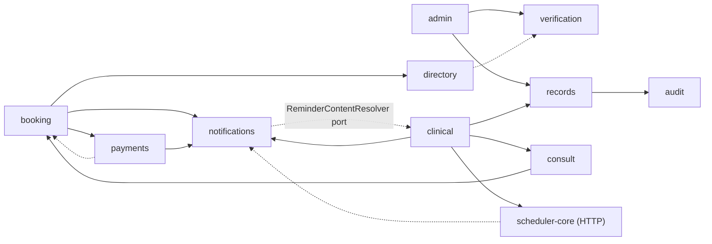

# Module boundaries and domain model (S-036)

**Phase P05 · Epic EP07 · Depends on:** S-034 ([architecture-overview.md](architecture-overview.md)) · **Contract refs:** K-ARC-01, K-ARC-02 · **Feature:** All, F10 · **Date:** 2026-11-15
**Status:** In Testing, until the founder approves the module map (acceptance criterion: module map approved; no shared tables across modules).

**Who this is for:** developers building any module, and the founder approving the module map.

This document is stack-neutral. Entity and field names are logical; the physical schema is written in each build story.

## 1. Boundary rules (how K-ARC-01 is made real)

| # | Rule | How it is enforced |
|---|---|---|
| B1 | **Each module owns one database schema.** No table belongs to two modules. | One migration folder per module; CI fails if a migration touches another module's schema. |
| B2 | **Each module connects with its own database role**, which has rights only on its own schema, plus INSERT-only on its outbox and the shared `audit_outbox` (see audit, section 3). | Database grants set by infrastructure code; a CI test tries a cross-schema read and expects it to fail. |
| B3 | **No foreign keys across schemas.** Cross-module references are plain IDs (for example `appointment_ref`). | Migration lint. |
| B4 | A module uses another module only through its **public interface** (`modules/<name>/public`) or by **subscribing to its events**. | Import-boundary lint: importing anything else from another module fails CI. |
| B5 | Needing another module's data often (for example, verification status in search)? Keep a **local read model**: a copy of the few fields needed, updated from events, owned by the subscriber and listed in the data inventory (K-DP-06). | Code review; inventory check. |
| B6 | **No transaction spans modules.** Side effects go through the transactional outbox. A multi-step process such as hold → pay → confirm is a saga with timeouts and compensations. | Code review; tests for each saga timeout. |
| B7 | **Shared code is only value types and utilities**, such as Money, IDs, time zones and error types. Never tables, never business rules. | Lint: the shared package may not import any module. |
| B8 | **Reporting and analytics never read module schemas directly.** They use scrubbed event exports (ADR-26, K-DP-04). The Admin console calls module interfaces. | Database grants (no reporting role on module schemas). |
| B9 | The **dependency graph has no cycles.** When two modules need each other, one defines an interface (a "port") and the other implements it, or they use events. | Lint: dependency-cycle check. |
| B10 | **scheduler-core is a separate service with its own database.** It never imports health modules and never stores health data (K-ARC-02). | Separate deployable and repo package; contract test that scheduler-core's schema has no free-text fields except the recurrence rule and the time zone. |

## 2. Module map (v1.0)

| Module | Responsibility | Owns (entities) | Public interface (examples) | Publishes | Subscribes to | May call |
|---|---|---|---|---|---|---|
| **identity** | Accounts, login, roles, devices, sessions, MFA | User, RoleAssignment, Device, Session, MfaFactor | `getActor`, `hasRole`, `stepUp` | `account.created`, `account.closed` | `rights.erasure_requested` | config |
| **verification** | Professional verification state machine and evidence | VerificationCase, Evidence, Check, Decision | `submit`, `decide` (Admin only), `status` | `verification.status_changed` | `rights.erasure_requested` | identity, config, adapters (verification) |
| **directory** | Doctor and clinic profiles, practices, search | Professional, Clinic, Practice, VerificationStatusView (read model) | `search`, `getPractice`, `getFee` | `practice.updated` | `verification.status_changed` | identity, config, adapters (geocoding) |
| **booking** | Availability, slots, holds, appointments, reconfirmation | AvailabilityRule, Slot, Hold, Appointment | `hold`, `checkout`, `cancel`, `markNoShow`, `getAppointment` | `appointment.held/confirmed/cancelled/no_show/completed` | `payment.captured`, `payment.failed`, `practice.updated`, `consult.ended` | directory, payments, notifications, config |
| **payments** | Orders on clinic accounts, webhooks, ledger, refunds, receipts, our subscription invoices | ClinicMerchantLink, Order, PaymentAttempt, WebhookEvent, LedgerEntry, Refund, Receipt, SubscriptionInvoice, ReconciliationRun | `createOrder`, `refundStatus` | `payment.captured/failed`, `refund.succeeded/failed` | `appointment.cancelled/no_show` (applies refund policy) | config, notifications, adapters (payments) |
| **consult** | Consult sessions, room tokens, connection proof, outcomes | ConsultSession, ParticipantJoin, ConsultOutcome | `join`, `getSession` | `consult.both_connected`, `consult.ended` | `appointment.confirmed/cancelled` | booking, identity, adapters (video) |
| **clinical** | Notes, prescriptions, rules engine, drug master, templates | ConsultNote (versions), Prescription (versions), PrescriptionItem, RuleCheckResult, DrugMasterEntry, Template | `draft`, `check`, `sign`, `getPrescription`; implements notifications' `ReminderContentResolver` | `prescription.signed`, `prescription.amended` | `rights.erasure_requested` | consult, records, notifications, scheduler-core (API), identity, config |
| **records** | Consent, documents, data-rights requests, patient's access-log view | Consent, Document, RightsRequest, RightsTask | `hasConsent`, `grant`, `revoke`, `storeDocument`, `accessLogFor` | `consent.granted/revoked`, `rights.erasure_requested`, `rights.export_requested` | `rights.task_done` (from every module) | identity, audit, config |
| **notifications** | Templates, preferences, quiet hours, dispatch, fallback, delivery logs | Template, Preference, Dispatch, DeliveryLog | `send(templateKey, recipientRef, vars)`; defines `ReminderContentResolver` | `notification.failed` | `occurrence.due` (from scheduler-core) | identity, config, adapters (SMS, push, email; WhatsApp disabled) |
| **admin** | Just-in-time staff access, grievances, support tickets | AccessGrant, Grievance, SupportTicket | `requestAccess`, `openGrievance` | `access.granted`, `access.break_glass` | — | every module's public interface (staff use only) |
| **audit** | Append-only, hash-chained audit events | AuditEvent | `record` (async), `query` (restricted) | — | — | — |
| **config** | Country packs, rule-set versions, feature flags | CountryPack, RuleSetVersion, FeatureFlag | `get`, `flag` | `config.changed` | — | — |
| **scheduler-core** (separate service) | Activities, recurrence, occurrences, due events | Subject, Activity, Occurrence | HTTP API: `createActivity`, `pause`, `cancel`, `listOccurrences` | `occurrence.due` (to the queue) | — | nothing in the Core API |

- **Reserved, not in v1.0:** family (F13), emergency (F9, F14), reviews (F15), labs (F1.2, F3), pharmacy (F1.1), homecare (F1.3, F4). The "nurse" role exists in identity but no nurse accounts are created (S-031 option A).
- **Every module may call `audit.record`, `config.get` and `identity.getActor`.** These arrows are left out of the graph below.

### 2.1 Dependency graph (calls; dashed = events only)

- **No cycles:** booking calls payments, and payments answers only with events. notifications reaches clinical only through a port that clinical implements, so notifications never imports clinical.
- **The hold → pay → confirm saga** is owned by booking. Its timeout (15 minutes) releases the slot. A late payment event for an expired hold makes payments refund automatically (E-PAY-01, E-PAY-02).

## 3. Domain model by module

States in **bold** are the lifecycle of the main entity.

### identity
- **User**: id, type (patient / professional / staff), phone (encrypted), status (**active → closed**).
- **RoleAssignment**: user, role (patient, doctor, clinic_admin, front_desk, nurse [reserved], staff roles), scope (clinic or global).
- **Device**: user, binding key, platform, last seen (patients: OTP + device binding, K-SEC-03).
- **Session**, **MfaFactor**: professionals and staff must have MFA.
- No Aadhaar field anywhere (K-DP-05).

### verification
- **VerificationCase**: professional ref, council, registration number, **draft → submitted → checking → needs_info → verified | rejected → suspended | expired**, next re-verification date.
- **Evidence**: object-storage ref, type (registration certificate, degree, photo ID other than Aadhaar), expiry.
- **Check**: source (manual / vendor / register), result, raw response ref, time.
- **Decision**: reviewer, outcome, reason code.

### directory
- **Professional**: name, qualifications, specialties, languages, council and registration number (as published under the NMC rules).
- **Clinic**: name, address, geo point, GSTIN (optional), payment mode (B or pay-at-clinic).
- **Practice**: professional at a clinic, consult modes offered, fee (one price, theme T04).
- **VerificationStatusView**: a read model fed by `verification.status_changed`. Search and booking show only Verified professionals (K-CS-01).

### booking
- **AvailabilityRule**: practice, weekly pattern, slot length, breaks, exceptions (leave, closure).
- **Slot**: materialised 30 days ahead; unique (practice, start).
- **Hold**: slot, patient, expires_at (15 minutes).
- **Appointment**: patient ref, practice ref, slot, mode (in person / video / audio), refund policy version, **held → pending_payment → confirmed → in_progress → completed | cancelled (by patient / doctor / clinic / system) | no_show (patient / doctor) | expired**.
- **ReconfirmationTask**: the day-before reconfirmation with the clinic (E-BK-07).

### payments
- **ClinicMerchantLink**: clinic ref, aggregator, credential **reference** (the secret lives in the secrets manager, never in the database), webhook secret reference, status.
- **Order**: appointment ref, amount (minor units) and currency, idempotency key, aggregator order ID.
- **PaymentAttempt**, **WebhookEvent** (stored raw, de-duplicated by event ID, signature result).
- **LedgerEntry**: append-only, double-entry. Balances are derived and never edited (K-PAY-04). Enforced by revoking UPDATE and DELETE from the module's role.
- **Refund**: reason (rule RF01–RF09), amount, **operation key** (unique: booking + rule), merchantRefundRef, providerRefundId (may be empty after a timeout), **requested → processing → unknown → succeeded | failed → escalated**. `unknown` is resolved with `findRefund`, never by a blind retry.
- **Order** also carries a unique operation key and merchantOrderRef, kept as a financial record (RET-04), separate from the 24-hour HTTP replay cache.
- **Receipt**: in the clinic's name (T5). **SubscriptionInvoice**: our flat fee to the clinic.
- **ReconciliationRun**: the daily comparison with aggregator reports.

### consult
- **ConsultSession**: appointment ref, provider room ref, **scheduled → open → both_connected → ended | failed_technical | no_show**.
- **ParticipantJoin**: who joined, when, how long (proves "both sides connected", E-BK-08).
- **ConsultOutcome**: completed (with prescription / without prescription / referred in person / emergency referral) / doctor no-show / patient no-show / technical failure. Drives refunds through booking events; every "completed" variant counts as a delivered consult.

### clinical
- **ConsultNote**: versions; signed versions are immutable (K-CS-05).
- **Prescription**: patient ref, prescriber ref, consult ref, rule-set version, **draft → checked → signed → amended (new version) | cancelled**.
- **PrescriptionItem**: drug master ref, strength, dose, frequency, duration, instructions, **exactly as entered by the doctor** (K-CS-03).
- **RuleCheckResult**: rule-set version, outcome, rule IDs hit.
- **DrugMasterEntry**: loaded from the country pack; category (prohibited, List O, List A or unclassified; List B depends on the consult context), per the [telemedicine rules spec](../clinical/telemedicine-rules-spec.md). Unclassified means blocked (fail closed).
- Sensitive fields (notes, items, diagnoses) use per-patient field encryption (K-DP-03).

### records
- **Consent**: patient, grantee (doctor or clinic), purpose, scope, start, expiry, revoked_at. Checked on every non-patient read (K-DP-02).
- **Document**: patient, type (upload / prescription PDF / report), object-storage ref, source, uploaded_at.
- **RightsRequest**: type (access, correction, erasure, export, nomination), deadline, state; **RightsTask**: one per module, done or failed.

### notifications
- **Template**: key, channel, locale, DLT template ID and header (SMS, K-MSG-01), version.
- **Preference**: channels per reminder type, medicine-names opt-in (K-DP-09), quiet hours, time zone.
- **Dispatch**: recipient ref, template key, channel order, attempts, **queued → sent → delivered | failed → fallback | dead_letter**.
- **DeliveryLog**: rolled off after RET-10.

### admin
- **AccessGrant**: staff, patient ref, reason code, scope, approver, start and end; break-glass flag (K-SEC-08).
- **Grievance**: reference, category, timers (7 days; 36 h unlawful content; 3 h orders; 2 h intimate images), state.
- **SupportTicket**.

### audit
- **AuditEvent**: actor, action, subject ref, purpose, time, previous hash, hash. Stores references, never content. A daily job checks the chain.
- **How events arrive:** `audit.record` is **not** fire-and-forget. It writes to an `audit_outbox` table in the caller's database transaction, using a write-only grant every module role has on that one table (the single exception to B2). For reads, the insert happens before data is returned, and a failed insert fails the read. The audit worker moves rows into the chained store and marks them done. An alert fires if the outbox backlog is older than 5 minutes.

### config
- **CountryPack** (for example `IN`): version, residency region, locales, emergency numbers, provider choices.
- **RuleSetVersion**: telemedicine rules, refund policy, DLT templates, tax values; each immutable once published.
- **FeatureFlag**: key, owner, end date, rollout; non-flaggable list enforced (release policy §5).

### scheduler-core (separate service, F10)
- **Subject**: opaque ID only. No name, phone or health data.
- **Activity**: owning app, external ref (for example a prescription item ID), type key (for example `med.dose`), RRULE, IANA time zone, start, end, **active → paused → ended | cancelled**.
- **Occurrence**: activity, due_at (UTC), **pending → dispatched → acknowledged | missed | cancelled**. Generated 14 days ahead.
- Reminder wording is built by notifications at send time through the clinical resolver ([data-inventory-v1.0.md](../data-inventory-v1.0.md) §4.9). That is why scheduler-core can become a standalone general-purpose app in v5.0.

## 4. Event catalogue (v1.0)

Every event carries: event ID, type, version, time, producer, subject reference. **Events carry references, not health content.** A subscriber that needs content calls the owner's interface, where consent and audit apply.

| Event | Producer | Main consumers | Payload (beyond the standard fields) |
|---|---|---|---|
| `verification.status_changed` | verification | directory, booking | professional ref, new status |
| `practice.updated` | directory | booking | practice ref |
| `appointment.confirmed` | booking | consult, notifications | appointment ref, mode |
| `appointment.cancelled` | booking | payments, consult | appointment ref, by whom, policy version |
| `appointment.no_show` | booking | payments | appointment ref, which side, policy version |
| `payment.captured` / `payment.failed` | payments | booking | order ref, appointment ref |
| `refund.succeeded` / `refund.failed` | payments | booking, notifications, admin | refund ref |
| `consult.both_connected` / `consult.ended` | consult | booking, clinical | session ref, outcome |
| `prescription.signed` / `prescription.amended` | clinical | records, notifications | prescription ref, version |
| `consent.granted` / `consent.revoked` | records | consent cache in all readers | consent ref |
| `rights.erasure_requested` | records | every module, scheduler-core | request ref, subject ref |
| `rights.task_done` | every module | records | request ref, module, outcome |
| `occurrence.due` | scheduler-core | notifications | occurrence ref, activity external ref, type key |
| `access.break_glass` | admin | alerting | grant ref |
| `config.changed` | config | all | pack, version |

## 5. What changes when a module is extracted later

1. Its public interface becomes an HTTP or messaging API with the same operations.
2. Its schema moves to its own database. This is easy, because no other module ever read it (B1–B3).
3. Its events already travel through the outbox and queue, so subscribers don't change.

## 6. Acceptance criteria check

| Criterion | Result |
|---|---|
| Module map written | **Yes**: section 2, 12 modules + scheduler-core, with reserved slots for later features |
| No shared tables across modules | **Yes, by design**: B1–B3 and B8, enforced by database grants and lint |
| scheduler-core kept separate | **Yes**: B10, section 3 |
| Module map approved | **Waiting for the founder** |

## 7. Changes from the Architecture sheet's module map

- **identity** keeps the "nurse" role reserved but creates no accounts (S-031).
- **booking ↔ payments:** booking orchestrates checkout; payments replies only with events, to avoid a cycle.
- **notifications** resolves reminder wording through a port implemented by clinical, so scheduler-core stays free of health data.
- **records** owns data-rights requests and tracks erasure across every module.
- **admin** owns grievance timers updated for the IT Rules amendment (7 days, 36 h, 3 h, 2 h).
