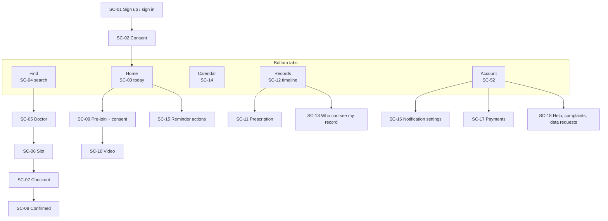

# Information architecture and navigation (S-046)

**Phase P09 · Epic EP11 · Depends on:** S-045 ([user-journeys.md](user-journeys.md)) · **Date:** 2026-11-15
**Status:** In Testing, until the founder signs off the navigation maps (acceptance criterion).

**Who this is for:** designers (S-077, S-078, S-086) and app developers. Screen IDs are from the Screens sheet. **New screens added in this story: SC-50 to SC-53.**

## 1. Apps and who uses them

| App | Users | Platforms | Notes |
|---|---|---|---|
| **Patient app** | Patients (adults only in v1.0) | Android, iOS | Separate from the Pro app, so patient and professional permissions never mix (ADR-04) |
| **Pro app** | Doctors (nurses reserved for v4.0) | Android, iOS | Day view, consults, quick actions |
| **Pro web** | Doctors, clinic admins, front desk | Desktop browser | Prescribing is mainly on desktop |
| **Admin console** | Internal staff | Desktop browser, restricted access | Phishing-resistant MFA, allow-list (TM-36) |
| **Public web** | Anyone | Browser | Landing, doctor pages, policies, **prescription verification (SC-51)** |

## 2. Patient app

| Tab | Holds | Sensitive (screenshot-protected, E-DP-08) |
|---|---|---|
| Home | Today's reminders and appointments; join button 10 min before an online consult | Yes |
| Find | Search, doctor profile, slot, checkout, confirmation | No (public data), except checkout |
| Calendar | Day, week and month views of reminders and appointments | Yes |
| Records | Timeline, prescriptions, uploads, sharing and access log | Yes |
| Account | Profile, privacy and consents, devices, notifications, payments, help, close account | Partly |

**SC-52 Account and privacy (new):**
- consents, with one toggle per optional purpose;
- signed-in devices, with remote sign-out (S-115);
- app lock;
- download my data;
- close account.

## 3. Pro app (doctor, mobile)

| Tab | Screens |
|---|---|
| Today | SC-22 today's list → SC-24 consult room |
| Availability | SC-21 |
| Verification | SC-19 status (shown first until Verified; nothing else works before that) |
| Account | Profile, MFA and devices, payments (SC-27) |

Prescribing on mobile opens SC-25 and SC-26 in a simplified layout. The same server-side rules and signing apply.

## 4. Pro web (doctor, clinic admin, front desk)

| Section | Doctor | Clinic admin | Front desk |
|---|---|---|---|
| Today (SC-22) | Yes | Yes | Yes (booking fields only) |
| Consult (SC-24) → Chart (SC-23) → Prescribe (SC-25) → Sign (SC-26) | Yes | No | No |
| Availability (SC-21) | Own | All clinic doctors | View only |
| Clinic set-up and verification (SC-20) | No | Yes | No |
| **Staff and roles (SC-50, new)** | No | Yes | No |
| **Payments and subscription (SC-27, renamed)** | Own consults | Clinic | No |
| Profile and security | Yes | Yes | Yes |

**SC-27 was "Earnings and payouts".** In clinic-collected mode we never pay out, so it now shows:
- payments received on the clinic's own account;
- refunds and their status;
- our subscription invoices.

The payout dashboard stays at v1.2 (SC-38).

## 5. Admin console

| Section | Screen | Who |
|---|---|---|
| Verification queue | SC-28 | Reviewers |
| Access requests and audit viewer | SC-29 | Security owner, approvers |
| Complaints and data-rights queue | SC-30 | Grievance Officer |
| **Payments and refund exceptions (SC-53, new)** | Failed refunds, clinics with low balance, reconciliation mismatches | Ops |
| Support lookup | Inside SC-29: bookings and payments without health data (S-172) | Support |

## 6. Public web

| Page | Notes |
|---|---|
| Landing and waitlist | S-047 (marketing, not in this batch) |
| Doctor profile pages | Public fields only; NMC publicity rules |
| Policies | Terms, privacy notices, refund, review policy, grievance page |
| **Verify a prescription (SC-51, new)** | Enter or scan the verification reference. Shows only "valid / not valid / amended", doctor name, registration number and date. **No patient name or medicines** (TM-20, E-SEC-07). **The reference is a random token of at least 128 bits (never sequential or derived from IDs); the page is rate-limited per IP; an unknown reference shows only "not found"** (compliance review R-09). |

## 7. Navigation rules (build rules)

| # | Rule | Why |
|---|---|---|
| N1 | **Notification deep links carry only an opaque ID.** The app opens, requires app lock if it is set, then loads content from the server. No health data in links or in notification payloads. | K-DP-09, E-DP-12 |
| N2 | Sensitive screens (Home, Calendar, Records, prescription, consult, chart) set the screenshot-block flag on Android and blur in the app switcher. | E-DP-08 |
| N3 | Step-up re-authentication happens **only** at: signing a prescription, erasing or exporting data, changing phone number, and adding a device. Not on every screen. | TM-04, E-SEC-10 |
| N4 | Consent is asked **where it applies:** P-SHARE in the consult flow, P-REMIND when a prescription arrives (if off). Never a wall of pop-ups at launch. | Consent texts |
| N5 | Back from checkout during a pending payment shows "payment in progress", **never** a second checkout. | E-PAY-01 |
| N6 | A doctor sees no navigation to patient lists outside today's and their own consults. There is **no "all patients" directory.** | Access tiers T1 to T4 |
| N7 | The "Not for emergencies, call 112" line is on the Find, Pre-join and consult screens. | C33 |
| N8 | Ratings are prompted only after a completed consult, can be dismissed, and never block navigation (v1.1). | E-REV-03 |
| N9 | WhatsApp settings are hidden while the hold is in place (SC-16). | Founder, 14 Nov 2026 |
| N10 | Every screen has empty, loading, error, offline and permission-denied states. | Screens sheet |

## 8. Changes made to the Screens sheet

- **SC-27** renamed to "Payments and subscription (clinic-collected)".
- **SC-16:** note that the WhatsApp opt-in is hidden while on hold.
- **New:** SC-50 Staff and roles (Pro web, clinic admin, v1.0) · SC-51 Verify a prescription (public web, v1.0) · SC-52 Account and privacy (patient, v1.0) · SC-53 Payments and refund exceptions (Admin, v1.0).

## 9. Sign-off

| Item | Founder decision |
|---|---|
| Navigation maps (sections 2 to 6) | ☐ Agree ☐ Change: |
| New screens SC-50 to SC-53 | ☐ Agree ☐ Change: |
| Name / date | |
