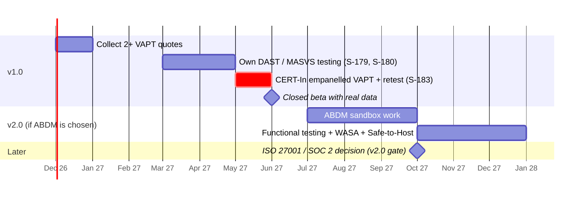

# Certification plan and budget (S-051)

**Phase P01 · Epic EP02 · Depends on:** S-008 · **Compliance:** C15, C31 (also C03, C07) · **Date:** 2026-11-15
**Status:** In Testing. The plan and timing are written. **The acceptance criterion also needs quotes from at least two auditors**, which the founder must collect using the request-for-quote scope in section 4. **No prices here are estimates**; the budget column stays blank until quotes arrive.

**Who this is for:** the founder (budget and auditor choice) and the security owner (scheduling).

## 1. What we need, and when

| # | Certification or test | Required? | For | When | Story | Lead time |
|---|---|---|---|---|---|---|
| 1 | **Independent VAPT** (vulnerability assessment and penetration test) of the v1.0 APIs, web apps and mobile apps by a **CERT-In empanelled auditor**, then a **retest** after fixes | Our own release gate. **Before any real patient data reaches v1.0 (closed beta).** Supports "reasonable security safeguards" (DPDP s.8(5), rule 6) and ASVS L2/MASVS (K-SEC-07). Not a statutory certificate for a private app [VALIDATE]. | v1.0 beta | After the feature-complete build on staging; before the beta (P12) | S-183 | Book 4–6 weeks ahead; test 1–2 weeks; retest about 1 week |
| 2 | Our own security testing: DAST on staging (OWASP ZAP), mobile MASVS testing | Release gate | v1.0 | Every release; before the VAPT | S-179, S-180 | — |
| 3 | **Repeat VAPT** | Policy: yearly, and after any major change (new payment mode, ABDM, new app) [CONFIRM] | v1.x onward | Yearly | — | As item 1 |
| 4 | **ABDM: functional testing** by an NHA-empanelled agency | Only if we join ABDM (our choice, not a legal duty for a private app [VALIDATE]) | v2.0 (ABHA linking, health records) | After sandbox integration | v2.0 ABDM epic | Reported 6–10 weeks with WASA [VALIDATE] |
| 5 | **ABDM: WASA** (web application security audit) by a CERT-In empanelled agency (some sources also accept STQC), leading to a **Safe-to-Host certificate** and vulnerability closure certificate | Needed for ABDM production keys | v2.0 | After functional testing | v2.0 ABDM epic | Included in item 4; a new certificate is needed after major changes |
| 6 | **ISO 27001 or SOC 2** | Voluntary. Useful for clinic chains, insurers and markets abroad | Later | **Decide at the v2.0 gate** (open decision 11) | — | 6–12 months for a first certification [VALIDATE] |
| 7 | DPDP **Significant Data Fiduciary** duties (yearly data protection impact assessment and audit) | **Only if the government notifies us as an SDF.** Not expected at our size [VALIDATE]. | — | Watch | — | — |
| 8 | Play Store and App Store health-app declarations | Required by the stores | v1.0 | With store submission | S-103, S-187 | 1–3 days per review |

**SPDI Rules, rule 8 (now until May 2027):** we must have a documented information-security programme and policies. It is written in [information-security-policy.md](information-security-policy.md) and must be approved before v0. **ISO 27001 certification is the "deemed compliance" route** under rule 8. If the founder wants that protection before the v2.0 gate (for example, if a clinic chain or insurer asks for it), bring item 6 forward [CONFIRM] (compliance review R-04).

**Plan from day 1 so later certifications are cheap.** The controls we build anyway map onto ISO 27001 Annex A and SOC 2:
- access control and just-in-time access;
- logging and audit;
- encryption and key management;
- backups and disaster recovery drills;
- incident response;
- vendor register;
- secure development (CI scans, code review).

We keep **evidence from the start**: drill reports, access reviews, scan results and change approvals.

## 2. Timeline (by phase)

*Dates are placeholders based on the sprint plan; the founder sets the real ones.*

## 3. Choosing an auditor

| Check | Why |
|---|---|
| Name on the **current CERT-In empanelled auditor list** (cert-in.org.in) at the date of the test | Empanelment is periodic and lapses; an out-of-date firm's report may not be accepted |
| Can also do **ABDM WASA**, and issue Safe-to-Host | Same firm for v1.0 and v2.0 saves time [CONFIRM] |
| **Retest included** in the price | Fixes must be verified |
| Covers **mobile (MASVS)** and **API (ASVS L2)**, not only web | Our main attack surface is the apps and the API |
| Testers use **staging with synthetic data only**; NDA; India-based team | No real patient data in testing (S-044 non-production rule) |
| Healthcare or fintech experience | Payments and health records |
| Report format: CVSS scores, steps to reproduce, fix advice, an executive summary for the founder | Usable by engineering |

## 4. Request-for-quote scope (send to at least two auditors)

> **Scope:** VAPT plus one retest.
> - **Patient app:** Android and iOS.
> - **Pro app:** Android and iOS.
> - **Web apps:** Pro web, Admin console and public web.
> - **REST API:** about [FILL: number] endpoints, OpenAPI spec provided.
> - **scheduler-core service.**
> - **Cloud configuration review:** India region; provider per ADR-09.
>
> **Approach:** grey box, with test accounts for every role (patient, doctor, clinic admin, front desk, reviewer, support, Grievance Officer).
>
> **Standards:** OWASP ASVS Level 2, OWASP MASVS, OWASP API Top 10.
>
> **Deliverables:** report with CVSS ratings, a retest report, and a certificate or letter of completion.
>
> **Environment:** staging, synthetic data only.
>
> **Timing:** [FILL] weeks before the beta.
>
> **Optional:** quote separately for ABDM WASA and Safe-to-Host (v2.0).

## 5. Budget table (fill from quotes)

| Item | Quote 1 (firm, date) | Quote 2 (firm, date) | Chosen | Notes |
|---|---|---|---|---|
| v1.0 VAPT + retest | | | | |
| ABDM functional testing (v2.0) | | | | NHA-empanelled agency |
| ABDM WASA + Safe-to-Host (v2.0) | | | | |
| Yearly repeat VAPT | | | | |
| ISO 27001 or SOC 2 (if chosen) | | | | Readiness, audit, surveillance |

## 6. Decisions for the founder

1. Collect at least two VAPT quotes (section 4) and choose the auditor.
2. Repeat-VAPT policy: yearly, and after major changes [CONFIRM].
3. Whether to join ABDM in v2.0. This decides items 4 and 5.
4. ISO 27001 or SOC 2 decision at the v2.0 gate.
