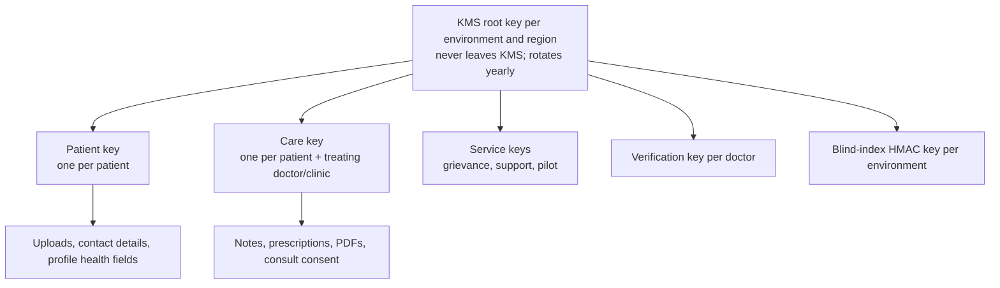

# Encryption design (S-056)

**Phase P06 · Epic EP08 · Depends on:** S-044 (classification, [data-inventory-v1.0.md](../data-inventory-v1.0.md) §4.0) · **Contract refs:** K-DP-03 (also K-DP-07, K-SEC-05) · **Edge cases:** E-DP-04, E-DP-05, E-DP-06, E-DP-19 · **Compliance:** C03 · **Date:** 2026-11-15
**Status:** In Testing, until the founder approves the design (acceptance criterion). It covers E-DP-04, E-DP-05 and E-DP-06 (section 9). Built in S-098; drilled in S-185.

**Who this is for:** the backend lead building the encryption library (S-098), the infra lead (keys, backups), and reviewers.

## 1. Layers

| Layer | What | Standard |
|---|---|---|
| In transit, public | Apps and browsers to the edge and API | **TLS 1.2 minimum, TLS 1.3 preferred**; forward-secret AEAD cipher suites only; HSTS with a long max-age; certificates auto-renewed |
| In transit, internal | API to the database, queue, scheduler-core and vendors | TLS on every connection, including inside the private network; the database rejects non-TLS connections |
| At rest, storage | Disks, database storage, snapshots, object storage, queue persistence | Provider encryption with **customer-managed keys** in the cloud key service (KMS), India region |
| **At rest, field level** | SH-C fields and contact details (K-DP-03) | **Application-level envelope encryption with per-patient keys** (this document) |
| Device | Patient and Pro apps | Platform keystore; encrypted local storage (S-061) |

Storage encryption protects against stolen disks and snapshots. **Field-level encryption** also protects against database dumps, over-broad queries and backups, and it makes **erasure by key destruction** (crypto-shredding) possible.

## 2. What is field-encrypted (from S-044)

| Data | Class | Key used |
|---|---|---|
| Clinical notes (all versions), diagnoses, prescription items, rules-engine decision details, prescription PDFs, teleconsult consent | SH-C, SH-L | **Care key** (§3) of the patient–doctor relationship |
| Patient uploads (files and their titles) | SH-C | **Patient key** |
| Reason for visit, free-text cancellation reasons | SH-C | Care key |
| Profile health fields (blood group, allergies, S-108), emergency contact | SH-C / PER | Patient key |
| Mobile number, email, nominee phone | PER (contact, K-DP-03) | Patient key, **plus a blind index** for lookup (§5) |
| Grievance and support free text | SH-C | **Service key** per record type (kept under RET-09, independent of account erasure) |
| v0 pilot data | SH-C | Pilot key, destroyed at RET-14 |
| Doctor ID document images | PER (high risk) | Verification key per doctor, destroyed 90 days after the decision |
| MFA secrets | PER-K | KMS-encrypted |
| OTPs, session and refresh tokens | PER-K | **Hashed, not encrypted** (never need decrypting) |

**Not field-encrypted, protected by storage encryption, access control and audit:** appointments, slot holds, join times, sharing grants, the access log and audit events (SH-L); names, date of birth (PER); financial records (PER-F). K-DP-03 does not list them, and they are needed for queries such as day views, reconciliation and the patient's own access log. **Revisit this if a risk review says otherwise** [CONFIRM].

## 3. Key hierarchy



- **Data keys** (patient, care, service and verification keys) are random 256-bit keys. They are stored **wrapped** (encrypted by the KMS root key) in a dedicated **key store** (§4), never in the module tables.
- **Why two kinds of patient key:** DPDP lets a patient erase their account, but the law requires clinical records to be kept for RET-02 (3 years after the last consult with that doctor).
  - **Erasing the patient key** removes everything erasable: uploads, contact details, profile. **It happens when the legal-minimum hold ends (RET-18), not at the moment of the erasure request.** Until then the data is restricted (data-rights flows §5).
  - **Care keys** are destroyed only when each relationship's retention period ends, unless a legal hold applies. This solves the conflict noted in data inventory §3.
- **Care key per patient–doctor relationship**, not per patient, because RET-02 runs separately for each doctor. Doctor A's records can then be destroyed on time while doctor B's are still in their period.
- **Algorithm:** AES-256-GCM with a random 96-bit nonce per encryption.
- **Associated data:** table, column and row ID, so a ciphertext copied into another row or column fails to decrypt (prevents swapping).

**Ciphertext format** (versioned, so the format can change later):

```
v1 | key_id | key_version | nonce(12) | ciphertext | tag(16)
```

## 4. The key store, and why crypto-shredding needs it (E-DP-04)

**The problem:** if a wrapped patient key sits in the normal database, it is also in **every database backup**. After an erasure, restoring an older backup would bring the wrapped key back, and the root key could unwrap it. **The "erased" data would be readable again.**

**The design:**
1. Wrapped data keys live in a **separate key store**: its own database, with its own role. Only the encryption library can reach it.
2. **Key-store backups are kept for at most the backup window** (RET-17, 35 days) and are encrypted under a separate key. They are never archived longer.
3. **Destroying a key** deletes its row and writes a **tombstone** (key ID, time, reason, never the key) to a destruction log. The destruction log is replicated to the DR region and is itself kept.
4. **Every restore** of the key store or the main database **re-applies the destruction log before the service opens** (release policy §6; S-062). A restored key that is tombstoned is destroyed again at once.
5. After the backup window, no copy of a destroyed key exists anywhere. The encrypted data in old database backups is then permanently unreadable.

**DR:** the key store is replicated to the DR region. Destruction applies in both regions, through the log, and is checked in the DR drill (S-185, TC-04).

## 5. Lookup without decrypting: blind index

Sign-in needs "find the account for this phone number" without decrypting every row.

- **How it works:** we store `HMAC-SHA-256(blind_index_key, normalised_E164_phone)` next to the encrypted phone. Lookups compute the same HMAC.
- **Why the key matters:** phone numbers have a small search space, so **the HMAC key must stay secret** in KMS or a secrets store, separate from the database. Anyone holding the database but not the key cannot brute-force numbers.
- **Erasure deletes the index value** with the account.
- **No other blind indexes in v1.0.** SH-C data is **never searchable**; drug search uses the drug master, which is Internal data (E-DP-19).

## 6. Rotation (E-DP-05)

| What | When | How (no downtime) |
|---|---|---|
| KMS root keys | Automatically every year | The KMS keeps old versions for unwrapping. Data keys are re-wrapped in the background (cheap: only the key store changes; data is untouched). |
| Data keys (patient, care, service) | **Only on suspected compromise**, or by policy for service keys every 2 years [CONFIRM] | A new key version is created. New writes use it. A background job re-encrypts rows and checks progress. Old versions stay readable until the job finishes, then are destroyed. |
| Blind-index key | Only on compromise | Dual-write both index values during migration, then switch |
| TLS certificates | Auto-renew before expiry | Managed certificates |

Reads always use the key version written in the ciphertext header, so reads and writes keep working during rotation.

## 7. Key service unavailable (E-DP-06)

- **Fail closed.** If a data key cannot be unwrapped, the read or write of that field **fails with a clear error**. There is **never a plaintext fallback**, and nothing sensitive is written unencrypted "to retry later".
- **Short in-memory cache** of unwrapped data keys (at most 5 minutes, in process memory only, never on disk or in Redis). This absorbs brief KMS blips.
- Features that need no sensitive fields keep working: search, slots, public profiles.
- **Alert** on KMS errors; the incident runbook applies if it lasts longer than 15 minutes.

## 8. Files (object storage)

- **Uploads and prescription PDFs are encrypted by the application before they reach storage.** Each file gets its own file key, wrapped by the patient key (uploads) or the care key (PDFs).
- Provider-side encryption alone cannot crypto-shred one patient's files.
- **Downloads** go through a short-lived, user-bound link (S-171). That link points to our download endpoint, which checks access, decrypts and streams the file. It never points at the raw object.
- Object versioning and replication copy only ciphertext.

## 9. Edge cases covered (acceptance criterion)

| Edge case | How | Test |
|---|---|---|
| **E-DP-04** deleted user's data still in backups | Patient key destroyed → erasable fields and files unreadable in every backup. Key-store backups ≤ 35 days; destruction log re-applied on every restore (§4). | TC-04 drill |
| **E-DP-05** key rotation during reads and writes | Versioned ciphertext header; root-key rotation re-wraps keys only; data-key rotation via a background job (§6) | TC-05 |
| **E-DP-06** key service unavailable | Fail closed; 5-minute in-memory key cache; alert (§7) | TC-06 |
| E-DP-19 caches and search indexes | No SH-C in indexes; caches of SH data encrypted with a short TTL; data keys never cached outside process memory | TC-13 |

## 10. Rules for the encryption library (S-098)

1. One shared library for every module. **No module calls KMS or a cipher directly** (lint check, S-092).
2. Field types mark encrypted columns, for example `Encrypted<CareKey>`, so it is impossible to store plaintext there by mistake.
3. Plaintext never goes to logs, errors or metrics (K-DP-04).
4. Test vectors and property tests for the ciphertext format; negative tests for associated-data mismatch, wrong key and tampered tag.
5. Performance budget: encrypting or decrypting a field must not break the API targets (read p95 under 300 ms). Load-tested in S-175.

## 11. Decisions [CONFIRM]

1. Care keys per patient–doctor relationship, so RET-02 can be applied per doctor.
2. SH-L data protected by storage encryption, access control and audit, not field-level encryption (§2).
3. Key-store backup window 35 days; after that, erasure is permanent everywhere.
4. Service-key rotation every 2 years.
