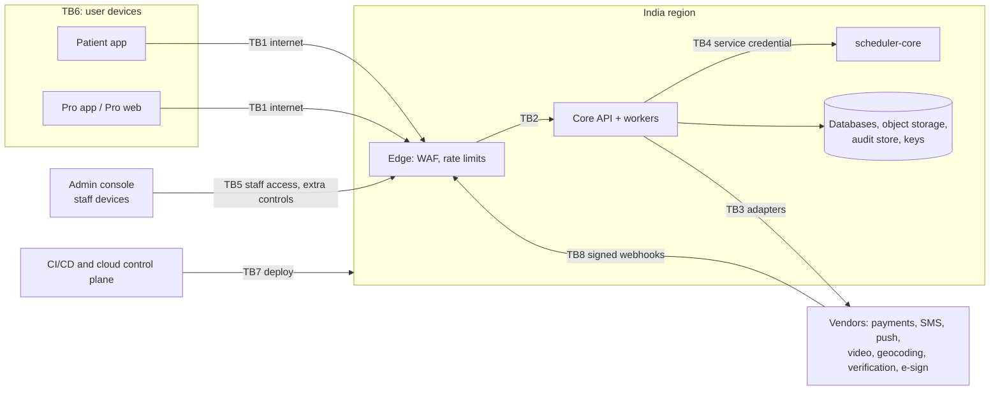

# Threat model, v1.0 (S-043)

**Phase P06 · Epic EP08 · Depends on:** S-034 ([architecture-overview.md](../arch/architecture-overview.md)) · **Contract refs:** K-SEC-07 (also K-SEC-01 to K-SEC-08, K-DP-01 to K-DP-09, K-CS-01 to K-CS-05, K-PAY-01 to K-PAY-04, K-ARC-02, K-ARC-03) · **Compliance:** C03 (also C01, C07) · **Edge cases:** E-DP-*, plus new E-SEC-01 to E-SEC-12 · **Date:** 2026-11-15
**Status:** Done (acceptance criterion: threats listed with owners; linked edge cases). It is reviewed again at every release gate, and checked end to end by S-178 ("every mitigation implemented and tested").

**Who this is for:** developers and reviewers building v1.0 stories; the security owner; the auditor doing VAPT (S-183).

**Method:** STRIDE (Spoofing, Tampering, Repudiation, Information disclosure, Denial of service, Elevation of privilege), applied to each v1.0 data flow in the architecture overview §5, plus the platform itself. The baseline is OWASP ASVS Level 2 for the API and web, and MASVS for mobile (K-SEC-07). The design is stack-neutral, so nothing here depends on the open stack decisions.

## 1. Owners (roles until people are named)

| Role | Owns |
|---|---|
| **Security owner** (founder until a security lead is hired) | This document, risk acceptance, VAPT, incident command (S-020) |
| **Backend lead** | API, authorisation, consent, audit, payments, rules engine, scheduler-core |
| **Mobile lead** | Patient app and Pro app, device storage, pinning |
| **Infra lead** | Cloud, networks, keys, backups, CI/CD |
| **Clinical reviewer** (registered doctor, S-029) | Rule files and clinical content (K-CS-07) |
| **Ops lead** | Verification reviews, Admin console use, vendor register |
| **Grievance Officer** | Data-rights requests, complaints |

## 2. What we protect (assets)

| ID | Asset | Why it matters |
|---|---|---|
| A1 | Health records: notes, diagnoses, prescriptions, uploads, consult metadata | Sensitive personal data. A breach harms patients and triggers DPDP and CERT-In duties. |
| A2 | Identity and contact data: phone, name, date of birth | Account takeover, profiling, spam |
| A3 | Consent and permission records | Decide who may see A1 (K-DP-02) |
| A4 | Money flows: orders, refunds, clinic merchant credentials | Fraud; refunds owed to patients |
| A5 | Doctor accounts and their ability to sign prescriptions | Forged prescriptions are a direct patient-safety risk |
| A6 | Audit log | Evidence for patients, regulators and incident response |
| A7 | Encryption keys | Protect A1 and A2; make erasure work (crypto-shredding) |
| A8 | Verification evidence and status | Only registered practitioners may practise (K-CS-01) |
| A9 | Availability: bookings, consults, reminders | Missed doses and missed consults harm patients |
| A10 | Country-pack rule files (telemedicine rules, refund policy, DLT templates) | A wrong rule allows prohibited drugs or wrong refunds |

## 3. Trust boundaries

## 4. Threats and mitigations

**Risk** = likelihood × impact before mitigation (H/M/L). **Status** for every row: *Designed* (in the architecture or a story). S-178 marks it *Implemented and tested*.

### 4.1 Sign-in and sessions (S-104, S-105, S-115)

| ID | STRIDE | Threat | Risk | Mitigation (where) | Owner | Edge cases |
|---|---|---|---|---|---|---|
| TM-01 | S | OTP guessing, or OTP intercepted through SIM swap or malware, leads to patient account takeover | H | OTP 6 digits, valid 5 min, max 5 attempts, then lock with backoff. Device binding; SMS-14 "new sign-in" alert on a new device. A new device cannot read health records until bound (K-SEC-03). | Backend lead | E-SEC-01, E-DP-22 |
| TM-02 | D | **SMS pumping (toll fraud):** bots trigger thousands of OTP SMS to premium or random numbers, running up cost and blocking real OTPs | H | Limits per number, device, IP and subnet. App attestation (Play Integrity, App Attest) on OTP requests. +91 numbers only in v1.0. Alert on OTP volume spikes; daily SMS spend cap with a kill switch (adapter A9). | Backend lead | E-SEC-01 |
| TM-03 | S | Phone number reassigned by the telco to a new person, who signs in and sees the old owner's records | H | Re-verification when the number has been unused for a long period or the device changes. A new owner never sees old data until the identity check passes (E-DP-22). | Backend lead | E-DP-22 |
| TM-04 | S, E | **Doctor account takeover** leads to fraudulent prescriptions or record browsing | H | Mandatory MFA with an app authenticator or passkey, not SMS-only (K-SEC-03). Step-up re-authentication to sign (P08), plus an electronic signature (P09). Alerts on a new device, an unusual prescription volume, or sign-ins from new places. Session timeout 30 min idle on Pro web [CONFIRM]. | Backend lead | E-SEC-02 |
| TM-05 | I | Stolen or lost phone, still signed in | M | App lock (biometric or PIN), encrypted local storage, remote sign-out (S-115), short access tokens (about 15 min) with device-bound refresh tokens. | Mobile lead | E-DP-07 |
| TM-06 | R | User denies an action ("I never cancelled") | L | Audit events for every state change (ADR-28), with device and time. | Backend lead | — |

### 4.2 Search, booking and payment (flow §5.1; S-119 to S-125, S-133, S-146, S-163)

| ID | STRIDE | Threat | Risk | Mitigation (where) | Owner | Edge cases |
|---|---|---|---|---|---|---|
| TM-07 | E, I | **IDOR:** a patient changes an appointment or prescription ID in a request and sees or cancels someone else's | H | Deny-by-default policy layer with an ownership check on every endpoint (K-SEC-04). 404, not 403, for others' resources (API standards §4). Opaque IDs. A generated authorisation test suite for every operation (S-116, S-181). | Backend lead | E-SEC-03, E-DP-16 |
| TM-08 | D | **Slot squatting:** a bot holds every slot of a doctor so real patients cannot book | M | At most 2 active holds per account. Holds expire in 15 min. Only verified accounts can hold. Rate limits on hold creation; alert on a hold-to-payment ratio anomaly. | Backend lead | E-SEC-04, E-BK-01 |
| TM-09 | S, T | **Forged or replayed payment webhook** confirms a booking without payment | H | Signature checked per clinic before anything else (adapter A7). Event ID de-duplicated. Order ID, amount and currency must match our order. Booking confirmed only after `getPaymentStatus` agrees, or a verified webhook. Daily reconciliation (S-146). | Backend lead | E-SEC-05, E-PAY-03 |
| TM-10 | T | Client sends a lower fee or a different clinic in the checkout request | M | The server computes the amount from the directory and booking. The client never sends the amount. | Backend lead | E-SEC-05 |
| TM-11 | I | Clinic merchant credentials leak, allowing refunds or orders on that clinic's account | H | Credentials only in the secrets manager, scoped per clinic. Never in the database, logs or config (K-SEC-05). Rotation on staff change; access to the secret is audited. | Infra lead | — |
| TM-12 | T, E | Repeated or inflated refunds through retries, a bug or a malicious insider | M | Refunds only from the versioned policy (K-PAY-05). A unique operation key per booking and rule (API standards §6). Manual refunds need two people and a reason, and are audited. Ledger is append-only (K-PAY-04). | Backend lead | E-PAY-05 |
| TM-13 | R, T | Clinic falsely marks a patient as no-show, or closes an online consult that never happened, to avoid a refund | M | "Completed" only when both sides joined (video join events). Under 2 minutes flagged. Patient can dispute for 24 h. Every mark is audited (E-BK-08). | Backend lead | E-BK-08, E-BK-04 |
| TM-14 | I | Search reveals a patient's location, or a doctor's private phone number | L | Patient location used only for the query and never logged; no reverse geocoding (adapter §10). Only public profile fields are searchable (E-DP-19). | Backend lead | E-DP-19 |

### 4.3 Consultation and prescription (flow §5.2; S-135 to S-139, S-147 to S-151, S-164, S-168, S-169)

| ID | STRIDE | Threat | Risk | Mitigation (where) | Owner | Edge cases |
|---|---|---|---|---|---|---|
| TM-15 | S | Someone other than the patient joins the video call (family member, impostor) | M | Join tokens bound to one participant and a time window. The doctor confirms identity at the start (S-147, rules check P02). | Backend lead | E-TC-03 |
| TM-16 | I | Video room token leaks, allowing someone to listen in | M | Short-lived tokens limited to the two participants. Room locked once both have joined. No recording (forced off and tested). India media region. | Backend lead | — |
| TM-17 | T, E | **Rules engine bypass:** a client or modified app sends an "allowed" flag, or calls the sign endpoint directly with a blocked drug | H | The rules are evaluated **only on the server**, and **re-run at signing** with all checks P01 to P10. The client never decides. Fail closed when no row matches (K-CS-02). | Backend lead | E-RX-01, E-SEC-06 |
| TM-18 | T | **Rule file tampering:** a malicious or careless change to the country-pack rule files allows prohibited drugs, or wrong refunds | H | Rule files change only through a reviewed PR: the clinical reviewer approves clinical rules (K-CS-07), the founder approves refunds. Published versions are immutable, and each prescription stores the version used. One test per table row. Config loader verifies the file checksum. Changes audit-logged; no config screen in v1.0 (S-173 Won't). | Backend lead + Clinical reviewer | E-SEC-06 |
| TM-19 | R | Doctor denies writing a prescription, or claims it was changed | M | Step-up (P08) and electronic signature over the document hash (P09). Signed versions immutable (K-CS-05). Audit event at signing. | Backend lead | E-SEC-07 |
| TM-20 | S, T | **Forged prescription PDF** taken to a pharmacy, or an edited genuine PDF | H | Signature on the hash (P09), plus a verification reference or QR code on the PDF that a pharmacist can check. The verification page shows only "valid / not valid", doctor name and date, never patient details. **The reference is a random token of at least 128 bits, not guessable or sequential; the page is rate-limited; unknown references reveal nothing** (review R-09) [CONFIRM design in S-150]. | Backend lead | E-SEC-07 |
| TM-21 | I | Doctor reads a patient's history without permission, or after access ended | H | Access tiers T1 to T4 ([consent-texts.md](../privacy/consent-texts.md) A2), checked on every read. Revocation clears the consent cache at once. Every read audited, and visible to the patient (S-170). | Backend lead | E-DP-01, E-DP-02 |
| TM-22 | I | Prescription PDF link forwarded or leaked | M | Short-lived links bound to the user; single use for sensitive files (S-171). | Backend lead | E-DP-21 |

### 4.4 Reminders and notifications (flow §5.3; S-127, S-140, S-141, S-152, S-156, S-165)

| ID | STRIDE | Threat | Risk | Mitigation (where) | Owner | Edge cases |
|---|---|---|---|---|---|---|
| TM-23 | I | Health details shown on the lock screen, or in SMS | M | Discreet text by default. Medicine names only with P-MEDNAMES. Never a diagnosis (K-DP-09). | Mobile lead | E-DP-12 |
| TM-24 | I | **Health data leaks into scheduler-core** through a careless field (for example a medicine name in the activity title) | M | Opaque references only. The scheduler-core API lint rule rejects free-text fields (S-038 fixture). Contract test on its schema (K-ARC-02). Wording resolved at send time by notifications. | Backend lead | E-SEC-08 |
| TM-25 | D | Push or SMS provider outage, so reminders are missed | M | Push → SMS fallback for critical items, a second SMS provider, and on-device backup for the next 72 h (S-165). Dead-letter queue with alerts. | Backend lead | E-REM-02 |
| TM-26 | S | Fraudsters send SMS pretending to be us (phishing for OTPs) | M | Only our DLT headers. We never send links except our whitelisted domain, and never ask for an OTP by SMS or call. The sign-in SMS says "Do not share it with anyone" (SMS-01). | Ops lead | — |
| TM-27 | T | A doctor or clinic name containing a URL or script reaches an SMS or push variable | L | Variables are typed (N/A) and validated; URLs never allowed in variables (messaging plan §4). Profile fields sanitised on input. | Backend lead | — |

### 4.5 Verification (flow §5.4; S-109 to S-111, S-129, S-160)

| ID | STRIDE | Threat | Risk | Mitigation (where) | Owner | Edge cases |
|---|---|---|---|---|---|---|
| TM-28 | S | **Impersonation:** someone uses a real doctor's registration number with forged ID documents | H | The name on the register must match the photo ID; council required. A short video call with the reviewer, comparing face to ID photo, for every new doctor in v1.0 [CONFIRM]. Phone and email confirmed by OTP. The doctor is told by SMS and email when a profile with their registration goes live. Never auto-approve on a mismatch. | Ops lead | E-SEC-09, E-VER-01, E-VER-02 |
| TM-29 | E | A reviewer approves a fake doctor, through error or collusion | M | Checklist in the review queue (S-129). Every decision audited with a reason. A second reviewer for any override of a failed check. Monthly sample re-check during the beta. | Ops lead | E-SEC-09 |
| TM-30 | I | Verification evidence (ID images) leaks | M | Encrypted object storage, private buckets. ID images deleted 90 days after the decision. Aadhaar cards rejected and deleted at once (AAD-04). Just-in-time staff access. | Infra lead | E-DP-27 |
| TM-31 | T | Licence suspended after onboarding, but the doctor keeps practising | H | Re-verification scheduler and complaint-triggered checks suspend listing and prescribing (S-160, S-118). During the beta: monthly manual check. | Ops lead | E-VER-03 |

### 4.6 Data rights and erasure (flow §5.6; S-142, S-143)

| ID | STRIDE | Threat | Risk | Mitigation (where) | Owner | Edge cases |
|---|---|---|---|---|---|---|
| TM-32 | S | Someone requests export or erasure of another person's data | M | In-app requests need step-up OTP. Requests to the Grievance Officer need the same identity check before action. Exports are sent only to the account, never to an email typed into the request. | Grievance Officer + Backend lead | E-SEC-10, E-DP-15 |
| TM-33 | D | An attacker who took over an account erases the patient's records | M | Erasure needs step-up re-authentication, plus a notice to the phone on file. Hard deletion runs after a short undo window (**proposed 7 days**, cancelled by the patient) unless the patient asks for immediate deletion [VALIDATE with lawyer against DPDP timelines]. Records under legal retention are restricted, not deleted (RET-02). | Backend lead | E-SEC-10, E-DP-03 |
| TM-34 | I | Export archive leaks | M | Encrypted archive, expiring link bound to the user (E-DP-15). | Backend lead | E-DP-15 |

### 4.7 Admin console and staff (S-128, S-172)

| ID | STRIDE | Threat | Risk | Mitigation (where) | Owner | Edge cases |
|---|---|---|---|---|---|---|
| TM-35 | I, E | Staff browse patient records out of curiosity | H | No standing access. Just-in-time access with reason, scope, approval and an end time. Break-glass raises an alert. Support lookup hides health data by default (S-172). Anomaly alerts (K-SEC-08). | Security owner | E-DP-16 |
| TM-36 | S | Staff phished, so an attacker gets Admin console access | H | Phishing-resistant MFA (passkeys or FIDO2 keys) for all staff. The Admin console sits behind an IP allow-list or zero-trust proxy. No shared accounts. Leavers removed the same day. | Infra lead | E-SEC-11 |

### 4.8 Data stores, keys and logs

| ID | STRIDE | Threat | Risk | Mitigation (where) | Owner | Edge cases |
|---|---|---|---|---|---|---|
| TM-37 | I | Database snapshot, backup or bucket exposed by misconfiguration | H | Field-level encryption of sensitive fields with per-patient keys (K-DP-03), so a raw copy is unreadable. Private networks. Infrastructure-as-code policy checks: no public buckets, no public database endpoints (S-093). | Infra lead | E-DP-04, E-DP-19 |
| TM-38 | T, R | **Audit log tampering** to hide access | M | Audit events written with the change (ADR-28), then hash-chained. Module roles can only INSERT. A daily chain check; a copy kept in write-once storage [CONFIRM cost]. | Backend lead | E-SEC-12 |
| TM-39 | D | Key service unavailable | M | Fail closed, never fall back to plaintext. Clear error; alert; cached data keys with short lifetimes (E-DP-06). | Infra lead | E-DP-06 |
| TM-40 | I | Personal or health data written to logs, traces or crash reports | H | Log scrubber (phones, names, Aadhaar pattern, health fields). A CI test with planted data fails the build. Crash reports have no request bodies (K-DP-04). | Backend lead | E-DP-13 |
| TM-41 | E | Injection (SQL, template, deserialisation) or server-side request forgery | M | Parameterised queries. No server fetch of user-supplied URLs; uploads go straight to storage through signed URLs. SAST in CI; DAST on staging (S-179); VAPT (S-183). | Backend lead | — |

### 4.9 Uploads (S-159, S-199)

| ID | STRIDE | Threat | Risk | Mitigation (where) | Owner | Edge cases |
|---|---|---|---|---|---|---|
| TM-42 | T, E | Malware or a disguised file type uploaded | M | Virus scan, type check by content not by extension, images re-encoded, size limits (E-DP-20). Files served with download headers from a separate domain. | Backend lead | E-DP-20 |
| TM-43 | I | Patient uploads an unmasked Aadhaar card | M | Warning before upload; immediate quarantine on report; hard deletion within 24 h (AAD-05). | Backend lead | E-DP-26 |

### 4.10 Mobile apps (S-061, S-180)

| ID | STRIDE | Threat | Risk | Mitigation (where) | Owner | Edge cases |
|---|---|---|---|---|---|---|
| TM-44 | I | Screenshots or screen recording of health screens | M | Blocked on Android for sensitive screens; warning on iOS (E-DP-08). | Mobile lead | E-DP-08 |
| TM-45 | I, T | Reverse engineering the app to find secrets or call internal APIs | M | **No secrets in the app.** Every check happens on the server. App attestation on sensitive endpoints. The certificate pinning decision is in S-061. | Mobile lead | — |
| TM-46 | I | Rooted or jailbroken device reads local data | M | Encrypted local storage with keys in the platform keystore. Warn on rooted devices; health caches cleared on sign-out (S-061). | Mobile lead | E-DP-07 |

### 4.11 Supply chain, CI/CD and vendors

| ID | STRIDE | Threat | Risk | Mitigation (where) | Owner | Edge cases |
|---|---|---|---|---|---|---|
| TM-47 | T, E | **Compromised dependency or CI runner** ships malicious code to production | H | Pinned dependencies with scanning; Critical findings block release (K-SEC-06). Protected main branch with required review. Signed build artefacts. Deploy credentials short-lived and only in CI. Production promotion by an approved person (release policy §3). | Infra lead | E-SEC-11 |
| TM-48 | I | Secret committed to the repo | M | Secret scanning blocks the merge (K-SEC-05); any leaked secret is rotated at once. | Infra lead | — |
| TM-49 | I | Vendor breach (SMS, verification, payments) exposes our users' data | M | Vendors get the minimum data (adapter A4). Processor agreements and India processing (K-DP-08). The breach runbook covers vendor incidents (E-DP-17). | Ops lead | E-DP-17 |
| TM-50 | D | Volumetric attack or abuse floods the API | M | CDN and WAF, rate limits per user and IP, autoscaling, and kill switches per feature (release policy §5). | Infra lead | — |

### 4.12 Incident response

| ID | STRIDE | Threat | Risk | Mitigation (where) | Owner | Edge cases |
|---|---|---|---|---|---|---|
| TM-51 | — | Breach detected at night or on a holiday, missing the 6-hour CERT-In clock | H | On-call rota, paging, templates ready, and the runbook (S-020, S-064). A drill before real patient data (S-184). | Security owner | E-DP-24 |

## 5. New edge cases added to the Edge Cases sheet

| E-ID | Scenario | Expected behaviour | Severity |
|---|---|---|---|
| E-SEC-01 | OTP guessing, or bots triggering mass OTP SMS (SMS pumping) | Attempts locked after 5 tries; per-number, device and IP limits; attestation; spend cap; alert. No OTP is ever logged. | High |
| E-SEC-02 | Doctor account used from a new device or at unusual volume | MFA required; step-up and e-signature to sign; alert to the doctor and security owner; signing blocked until re-verified if anomalous | Critical |
| E-SEC-03 | Patient changes an ID in a request to reach another patient's booking or prescription | 404; nothing revealed; event logged; the authorisation test suite covers every endpoint | Critical |
| E-SEC-04 | One account holds many slots at once | No more than 2 active holds per account; extra holds refused; alert on anomaly | Medium |
| E-SEC-05 | Forged, replayed or mismatched payment webhook; client-sent amount | Rejected unless the signature, event ID, order, amount and currency all match; the server calculates the amount | Critical |
| E-SEC-06 | Prescribing rule file changed without clinical review, or a client claims an item is allowed | Change cannot merge without the clinical reviewer's approval; loader verifies checksum; server re-runs rules at signing; fail closed | Critical |
| E-SEC-07 | Forged or edited prescription PDF | Signature check fails; verification reference shows "not valid"; no patient data on the verification page | High |
| E-SEC-08 | A health field is sent to scheduler-core | Lint and contract test fail the build; runtime validation rejects the field | High |
| E-SEC-09 | Someone registers with a real doctor's registration number | Name, ID and video check by the reviewer; the real doctor is notified when a profile goes live; never auto-approved | Critical |
| E-SEC-10 | Export or erasure requested by someone other than the patient, or by an attacker in a taken-over account | Step-up identity check; notice to the phone on file; undo window before hard deletion (lawyer to confirm); legal-retention records restricted, not deleted | High |
| E-SEC-11 | Staff credentials phished, or a CI runner compromised | Phishing-resistant MFA and an allow-list block access; signed artefacts and approved promotion block a rogue deploy | Critical |
| E-SEC-12 | Someone edits or deletes audit events | Insert-only grants; daily hash-chain check alerts on any break; copy in write-once storage | High |

## 6. Items for other stories

| Story | Take from this model |
|---|---|
| S-056 encryption, S-062 backups | TM-37, TM-39 |
| S-057 consent, S-058 access control | TM-07, TM-21, TM-35, tiers T1 to T4 |
| S-059 audit | TM-38, TM-40 |
| S-060 data rights | TM-32 to TM-34 (undo window for lawyer check) |
| S-061 mobile | TM-05, TM-44 to TM-46 |
| S-104, S-105, S-115 identity | TM-01 to TM-05 |
| S-121, S-124, S-125 booking and payments | TM-08 to TM-12 |
| S-138, S-150 prescribing | TM-17 to TM-20 (verification reference on the PDF) |
| S-110, S-129, S-160 verification | TM-28 to TM-31 (video check proposal) |
| S-093, S-094 infrastructure and delivery | TM-37, TM-47, TM-48, TM-50 |
| S-178 | Mark every TM row Implemented and tested before release |

## 7. Decisions for the founder [CONFIRM]

1. A short reviewer video call for every new doctor in v1.0 (TM-28).
2. Pro web idle timeout of 30 minutes (TM-04).
3. A 7-day undo window before hard erasure, unless the patient asks for immediate deletion. The lawyer must confirm this fits DPDP (TM-33).
4. Write-once copy of the audit log (TM-38): small cost, strong evidence.
5. Prescription verification reference or QR code on the PDF (TM-20).
